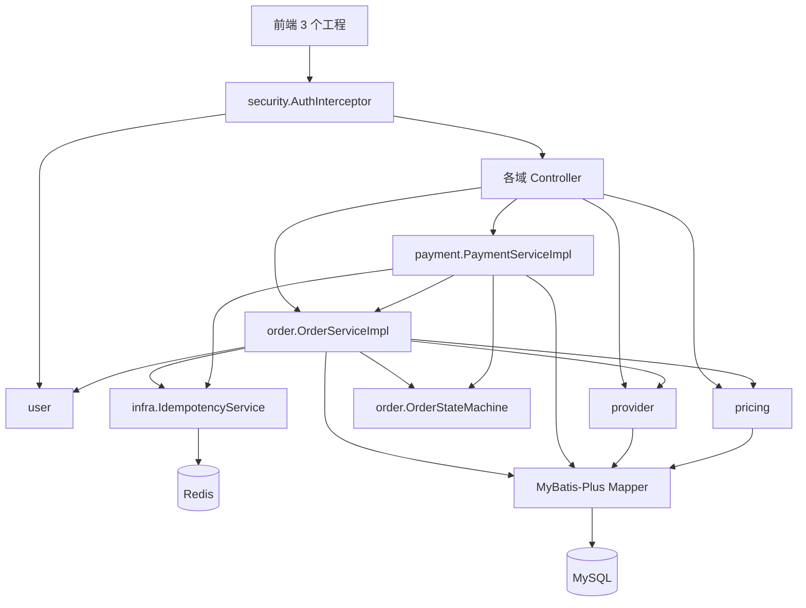
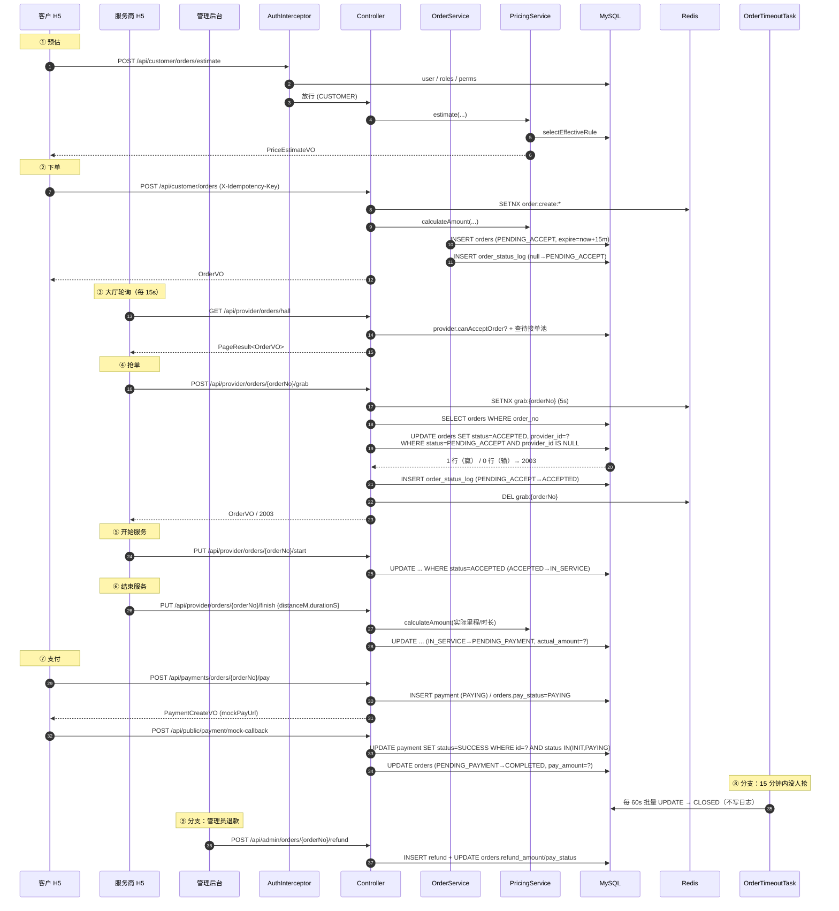
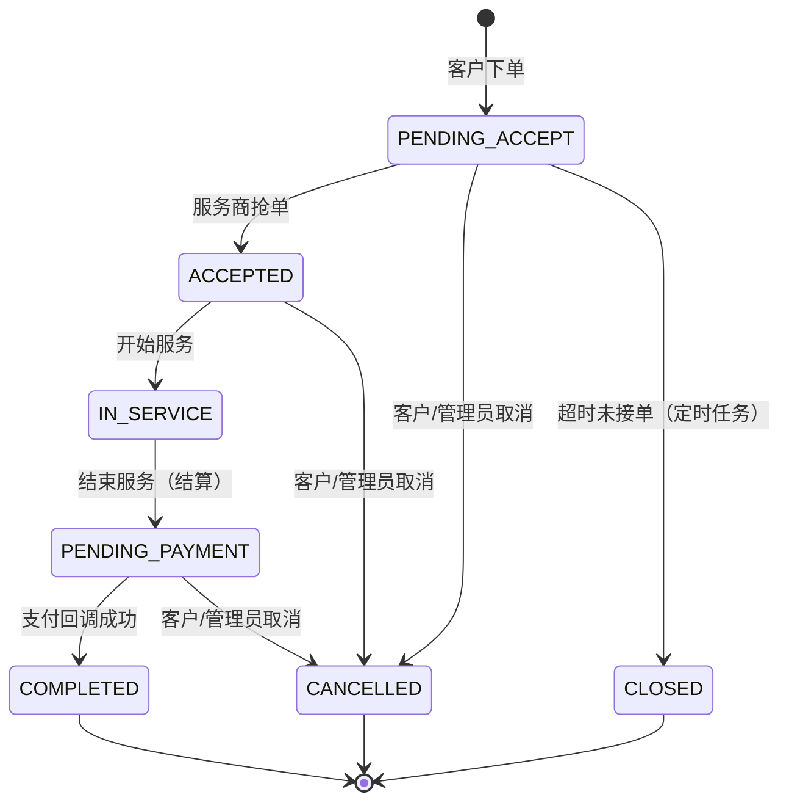
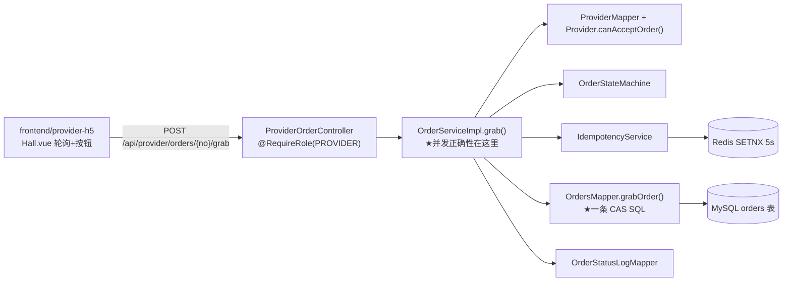
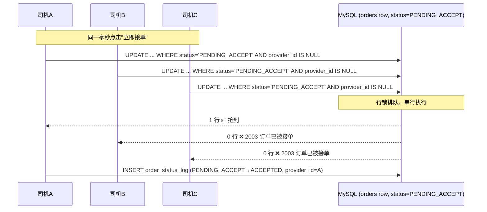

# 代驾代办 H5 平台 —— 模块协作与数据流学习文档

> 适用读者：需要快速读懂本项目、准备讲解或面试、或者要在此基础上继续开发的同学。
> 阅读方式：先看第 1~5 章建立"全局地图"，再看第 6~8 章的逐功能链路和时序，最后精读第 9 章的「司机抢单」专题。
> 文中所有结论都对应真实代码，关键位置给出 `文件:行号`。
>
> 🖼 **图形版：** 同目录下的 [`项目图解.html`](项目图解.html) 把这 12 章压缩成 10 张图（系统全景、请求链路、协作矩阵、状态机、抢单并发、支付退款、防重、ER 图、缺口清单）。用浏览器直接打开即可，无需任何依赖，也可 Ctrl+P 存成 PDF。

---

## 目录

1. [项目全景](#1-项目全景)
2. [后端模块地图](#2-后端模块地图)
3. [前端模块地图](#3-前端模块地图)
4. [横切约定：所有模块共同遵守的规则](#4-横切约定所有模块共同遵守的规则)
5. [功能 → 协作模块矩阵](#5-功能--协作模块矩阵)
6. [逐功能调用链与数据流](#6-逐功能调用链与数据流)
7. [端到端主链路时序](#7-端到端主链路时序)
8. [数据模型与状态机](#8-数据模型与状态机)
9. [专题：司机抢单到底是怎么处理的](#9-专题司机抢单到底是怎么处理的)
10. [设计亮点总结](#10-设计亮点总结)
11. [已知缺口与改进建议](#11-已知缺口与改进建议)
12. [学习路径与自测题](#12-学习路径与自测题)

---

## 1. 项目全景

### 1.1 它是什么

一个"代驾 + 代办"的 H5 服务平台，包含 **1 个后端 + 3 个独立前端工程**：

| 工程 | 目录 | 端口 | 使用者 | 核心页面 |
|---|---|---|---|---|
| 后端 API | [`backend/`](../backend) | 8080 | — | — |
| 客户 H5 | [`frontend/customer-h5`](../frontend/customer-h5) | 5174 | 客户 CUSTOMER | 下单、支付、订单详情 |
| 服务商 H5 | [`frontend/provider-h5`](../frontend/provider-h5) | 5175 | 司机/服务商 PROVIDER | **接单大厅**、我的订单、接单设置 |
| 管理后台 | [`frontend/admin`](../frontend/admin) | 5173 | 运营 ADMIN | 用户/角色/服务商/订单/计价规则 |

三个前端都是 Vite + Vue 3 + Element Plus，通过 Vite 的 `server.proxy` 把 `/api` 代理到 `http://localhost:8080`（例如 [`provider-h5/vite.config.js:15`](../frontend/provider-h5/vite.config.js)），所以后端不需要为开发环境配 CORS；生产环境才依赖 [`WebConfig.java:49`](../backend/src/main/java/com/daijia/config/WebConfig.java) 的跨域配置。

**关键认知：三个前端共用同一个后端和同一套账号体系**，角色由 `sys_user_role` → `sys_role.role_code` 决定，接口用 `@RequireRole` 隔离。

### 1.2 技术栈

| 层次 | 选型 | 版本 |
|---|---|---|
| 运行时 | Java | 21 |
| 框架 | Spring Boot | 3.2.5 |
| 持久层 | MyBatis-Plus | 3.5.5 |
| 数据库 | MySQL 8 | — |
| 缓存 | Redis（Spring Data Redis + Lettuce） | — |
| 认证 | JWT（jjwt） | 0.12.5 |
| 接口文档 | springdoc-openapi | 2.3.0 |
| 前端 | Vue 3 + Vite + Element Plus + Pinia + Vue Router | — |

见 [`backend/pom.xml`](../backend/pom.xml)。

### 1.3 领域概念速查

| 概念 | 代码枚举 | 取值 |
|---|---|---|
| 订单类型 | `OrderType` | `IMMEDIATE` 即时代驾 / `SCHEDULED` 预约代驾 / `INSPECTION` 年审代办 / `RENEWAL` 换证代办 |
| 订单状态 | `OrderStatus` | `PENDING_ACCEPT` / `ACCEPTED` / `IN_SERVICE` / `PENDING_PAYMENT` / `COMPLETED` / `CANCELLED` / `CLOSED` |
| 支付状态（订单上） | `PayStatus` | `UNPAID` / `PAYING` / `PAID` / `REFUNDING` / `PARTIAL_REFUNDED` / `REFUNDED` |
| 支付单状态 | `PaymentStatus` | `INIT` / `PAYING` / `SUCCESS` / `FAILED` / `CLOSED` / `REFUNDED` |
| 操作人类型 | `OperatorType` | 1 客户 / 2 服务商 / 3 管理员 / 4 系统 |
| 用户类型 | `UserType` | 1 客户 / 2 服务商 / 3 管理员 |

> ⚠️ 第一个容易踩的坑：**`PayStatus` 和 `PaymentStatus` 是两套东西**。前者是订单上的"这笔钱收了没"，后者是支付单的"这次支付请求走到哪一步"。两者由 `PaymentServiceImpl` 同时维护。

---

## 2. 后端模块地图

包根 `com.daijia`，按 **业务域分包 + 标准分层** 组织。每个业务包内部都是同一套四件套：`controller` / `service`(+`impl`) / `mapper` / `entity` + `dto` + `enums`。

```
com.daijia
├── DaijiaApplication.java      @SpringBootApplication + @MapperScan + @EnableScheduling
├── common/       统一响应、错误码、异常、分页、单号生成
├── config/       MyBatis-Plus 插件、字段自动填充、拦截器注册与 CORS、OpenAPI
├── security/     JWT、密码、拦截器、UserContext、@RequireRole
├── infra/        Redis 帮助类、幂等控制、订单配置
├── user/         认证、系统用户、角色、权限
├── provider/     服务商（司机）档案
├── pricing/      计价规则与计费算法
├── order/        订单主体、状态机、超时任务
└── payment/      支付单、退款单、模拟回调
```

### 2.1 各包职责与关键类

| 包 | 职责 | 关键类 | 依赖谁 |
|---|---|---|---|
| `common` | 所有层的公共契约 | `Result` 统一响应、`ResultCode` 错误码字典、`BusinessException`、`GlobalExceptionHandler`、`PageQuery`/`PageResult`、`NoGenerator` | 无（最底层） |
| `config` | 框架级装配 | `MybatisPlusConfig`（乐观锁+分页插件）、`MyMetaObjectHandler`（`createTime`/`updateTime` 自动填充）、`WebConfig`（拦截器+白名单+CORS） | `security` |
| `security` | 认证与鉴权 | `JwtUtil`、`PasswordEncoder`（PBKDF2）、`AuthInterceptor`、`UserContext`（ThreadLocal）、`LoginUser`、`RequireRole` | `user.mapper`、`common` |
| `infra` | 与业务无关的基础设施 | `RedisHelper`（带熔断降级）、`IdempotencyService`（幂等令牌）、`AppRedisProperties`、`OrderProperties` | Redis |
| `user` | 账号/角色/权限 | `AuthService/Impl`、`SysUserService`、`SysRoleService`、`AuthController`、`AdminUserController`、`AdminRoleController`、`AdminPermissionController` | `security` |
| `provider` | 司机档案与接单资格 | `Provider`（含 `canAcceptOrder()`）、`ProviderServiceImpl`、`ProviderMapper.selectByUserId`、`ProviderProfileController`、`AdminProviderController` | `user`、`common` |
| `pricing` | 计费规则与金额计算 | `PricingServiceImpl`（`doCalculate` 核心算法）、`PricingRuleMapper.selectEffectiveRule`、`AdminPricingController` | `order.enums`（`OrderType`） |
| `order` | 订单主流程 | `OrderServiceImpl`、`OrderStateMachine`、`OrdersMapper`（CAS SQL）、`OrderTimeoutTask`、三个 Controller（customer/provider/admin） | `pricing`、`provider`、`user`、`infra` |
| `payment` | 支付与退款 | `PaymentServiceImpl`、`PaymentMapper`（`markPaid`/`markRefunded`）、`MockPaymentCallbackController`、`PaymentController` | `order`、`infra` |

### 2.2 依赖方向（谁调用谁）



**要点：`payment` 依赖 `order`，`order` 不依赖 `payment`。** 订单不知道支付的存在；支付成功时由 `payment` 反过来调用 `OrderService.getByOrderNoOrThrow` 和 `OrdersMapper.casStatus` 把订单推进到 `COMPLETED`。这是单向依赖，避免了循环。

### 2.3 一个容易被忽略的"隐藏模块"

`OrderStateMachine`（[`OrderStateMachine.java`](../backend/src/main/java/com/daijia/order/service/OrderStateMachine.java)）不是普通 Service，它是一个**无状态规则表**：用 `EnumMap<OrderStatus, EnumSet<OrderStatus>>` 声明 7 个状态之间哪些迁移合法（第 37~65 行），并把终态（`COMPLETED`/`CANCELLED`/`CLOSED`）设为 `emptySet()`。

它的价值是：**所有状态变更都从同一张表校验**，`order` 和 `payment` 两个模块都复用它，所以"支付回调把订单推到 COMPLETED"和"司机结束服务把订单推到 PENDING_PAYMENT"走的是同一个校验器。

---

## 3. 前端模块地图

### 3.1 三端的目录结构完全同构

```
src/
├── main.js        挂载 Vue + Element Plus + Pinia + Router
├── App.vue
├── api/           一个业务域一个文件，只做 request.xxx 封装
├── utils/
│   ├── request.js   axios 实例 + 请求/响应拦截器（统一注入 token、统一弹错）
│   └── format.js    枚举中文映射、金额/时间/距离格式化
├── stores/user.js   Pinia：token、userInfo、roles、permissions
├── router/index.js  路由表 + 全局前置守卫
├── views/           页面
└── components/      TabBar、Timeline 等
```

### 3.2 `request.js` 是前端最关键的一个文件

[`provider-h5/src/utils/request.js`](../frontend/provider-h5/src/utils/request.js) 做了三件事：

1. **请求拦截**（第 13~24 行）：从 `localStorage` 取 `provider_token`，塞进 `Authorization: Bearer <token>`。
   > 注意 token 的 key 三端不同（`provider_token` / `customer_token` / `admin_token`），因为三个前端可能同时开在同一浏览器的不同端口，localStorage 是**按 origin** 隔离的，端口不同即不同 origin，所以其实不会互相覆盖 —— 但这是刻意的防御性设计。
2. **响应拦截成功分支**（第 37~52 行）：后端 HTTP 状态码永远是 200，业务结果在 `body.code`。`code === 200` 直接返回 `res.data`（所以页面里 `await getHallOrders()` 拿到的是分页对象本身，不是 `AxiosResponse`）；`code === 401` 清 token 跳登录；其它 `code` 统一 `ElMessage.error(res.message)` 并 reject。
3. **响应拦截失败分支**（第 53~68 行）：网络层错误（超时、5xx）的兜底。

**这解释了一个学习时最容易困惑的现象**：页面里的 `catch (e)` 经常是空的，注释写"错误提示已在拦截器中统一处理"。因为提示确实已经弹过了，页面只需要负责**状态回滚/刷新**（例如 `Hall.vue` 抢单失败后重新拉列表）。

### 3.3 各端页面清单

| 端 | 路由 | 页面文件 | 作用 |
|---|---|---|---|
| 客户 | `/` | [`customer-h5/src/views/Home.vue`](../frontend/customer-h5/src/views/Home.vue) | 选服务类型 → 模拟里程 → 预估 → 下单 |
| 客户 | `/orders`、`/orders/:orderNo` | `Orders.vue`、`OrderDetail.vue` | 我的订单、详情+时间线+支付/取消 |
| 客户 | `/pay-result` | `PayResult.vue` | 支付结果 |
| 服务商 | `/hall` | [`provider-h5/src/views/Hall.vue`](../frontend/provider-h5/src/views/Hall.vue) | **接单大厅**（15s 轮询 + 抢单按钮） |
| 服务商 | `/orders`、`/order/:orderNo` | `Orders.vue`、[`OrderDetail.vue`](../frontend/provider-h5/src/views/OrderDetail.vue) | 我的订单、接单/开始/结束服务 |
| 服务商 | `/mine` | [`provider-h5/src/views/Mine.vue`](../frontend/provider-h5/src/views/Mine.vue) | 在线状态、接单开关 |
| 管理 | `/system/user` `/system/provider` `/system/role` `/order` `/pricing` | `admin/src/views/**` | 后台 CRUD |

---

## 4. 横切约定：所有模块共同遵守的规则

这一章是"为什么模块能协作"的前提。**不理解这 7 条，看后面的链路会处处疑惑。**

| # | 约定 | 实现位置 | 协作影响 |
|---|---|---|---|
| 1 | **统一响应体** `{code, message, data}`，成功 `code=200` | [`Result.java`](../backend/src/main/java/com/daijia/common/Result.java) | 所有 Controller 返回 `Result<T>`，前端只需一套拦截器 |
| 2 | **业务异常统一抛 `BusinessException(ResultCode, msg)`**，由 `@RestControllerAdvice` 兜底转 `Result` | [`GlobalExceptionHandler.java`](../backend/src/main/java/com/daijia/common/GlobalExceptionHandler.java) | Service 层不需要 try-catch，也不用关心 HTTP 状态码 |
| 3 | **HTTP 状态码永远是 200**，错误靠 `code` 表达 | 同上 | 前端拦截器必须在"成功分支"里判断 `res.code` |
| 4 | **金额一律用 `int` 存"分"**，DB 用 `INT`，VO 额外给 `xxxYuan` 字符串 | `init.sql` 注释、[`OrderVO.java:56`](../backend/src/main/java/com/daijia/order/dto/OrderVO.java) | 计价、支付、退款三模块之间传的金额都是分，不会出现精度不一致 |
| 5 | **逻辑删除**：每张表有 `deleted`，实体标 `@TableLogic` | [`application.yml:23`](../backend/src/main/resources/application.yml) + 各 entity | ⚠️ **自定义 `@Update`/`@Select` 必须手写 `deleted = 0`**，MyBatis-Plus 只对自动生成的 SQL 追加条件 |
| 6 | **审计字段自动填充**：`createTime`(INSERT) / `updateTime`(INSERT_UPDATE) | [`MyMetaObjectHandler.java`](../backend/src/main/java/com/daijia/config/MyMetaObjectHandler.java) | 任何 `insert` 都不用手动 set 时间 |
| 7 | **SQL 里自己写 `version = version + 1`** | `OrdersMapper` 的三个 `@Update` | `@Version` 乐观锁只作用于 `updateById`；`casStatus`/`grabOrder` 这类条件更新是手写自增 |

第 7 条特别值得记：因为 `@Version` + `OptimisticLockerInnerInterceptor` 只在 `updateById` / `update(entity, wrapper)` 且 `entity.version != null` 时生效。而 `OrderServiceImpl` 里大量使用 `ordersMapper.update(null, lambdaUpdate().set(...))`，**这种写法不会自动递增 version**。所以项目在关键的并发路径上改用"手写 CAS SQL"，把并发控制显式化。

---

## 5. 功能 → 协作模块矩阵

### 5.1 总表（按功能查"谁和谁合作"）

| 功能 | 前端入口 | Controller | Service 主逻辑 | 协作方（被调用的其它模块） | 落库表 |
|---|---|---|---|---|---|
| 登录 | `Login.vue` → `api/auth.js` | `AuthController.login` | `AuthServiceImpl.login` | `PasswordEncoder`、`JwtUtil`、`SysRoleMapper` | `sys_user`、`sys_user_role` |
| 注册 | 同上 | `AuthController.register` | `AuthServiceImpl.register` | `PasswordEncoder`、`SysUserRoleMapper` | `sys_user`、`sys_user_role` |
| 取当前用户 | 路由守卫 | `AuthController.me` | `AuthServiceImpl.currentUser` | `SysRoleMapper`、`SysPermissionMapper` | `sys_user`、`sys_role`、`sys_permission` |
| 请求鉴权 | 所有页面 | `AuthInterceptor.preHandle` | — | `JwtUtil`、`SysUserMapper`、`SysRoleMapper`、`SysPermissionMapper`、`UserContext` | 5 张权限表 |
| **价格预估** | `Home.vue` → `estimateOrder` | `CustomerOrderController.estimate` | `PricingServiceImpl.estimate` | `PricingRuleMapper.selectEffectiveRule` | `pricing_rule` |
| **客户下单** | `Home.vue` → `createOrder` | `CustomerOrderController.create` | `OrderServiceImpl.create` | `IdempotencyService`、`PricingService`、`NoGenerator`、`OrderProperties`、`SysUserMapper` | `orders`、`order_status_log` |
| 客户查单/详情 | `Orders.vue`/`OrderDetail.vue` | `CustomerOrderController.page/detail` | `OrderServiceImpl.pageForCustomer/customerDetail` | `OrderStatusLogMapper`、`SysUserMapper`、`ProviderMapper` | `orders`、`order_status_log`、`sys_user`、`provider` |
| 客户取消 | `OrderDetail.vue` | `CustomerOrderController.cancel` | `OrderServiceImpl.cancelByCustomer` → `cancelOrder` | `OrderStateMachine` | `orders`、`order_status_log` |
| **接单大厅** | `Hall.vue` → `getHallOrders` | `ProviderOrderController.hall` | `OrderServiceImpl.pageHall` | `ProviderMapper`、`Provider.canAcceptOrder` | `orders`、`provider` |
| **抢单** | `Hall.vue` → `grabOrder` | `ProviderOrderController.grab` | `OrderServiceImpl.grab` | `ProviderMapper`、`IdempotencyService`、`OrderStateMachine`、`OrdersMapper.grabOrder`、`SysUserMapper` | `orders`、`order_status_log` |
| 开始服务 | `OrderDetail.vue` | `ProviderOrderController.start` | `OrderServiceImpl.startService` | `OrderStateMachine`、`OrdersMapper.casStatus` | `orders`、`order_status_log` |
| 结束服务（结算） | `OrderDetail.vue` 弹窗 | `ProviderOrderController.finish` | `OrderServiceImpl.finishService` | `OrderStateMachine`、**`PricingService.calculateAmount`** | `orders`、`order_status_log` |
| 发起支付 | `OrderDetail.vue` → `api/payment.js` | `PaymentController.pay` | `PaymentServiceImpl.createPayment` | `OrderService`、`PaymentMapper`、`IdempotencyService`、`NoGenerator` | `payment`、`orders` |
| 支付回调（模拟） | 支付页回调 | `MockPaymentCallbackController` | `PaymentServiceImpl.handleCallback` | `PaymentMapper.markPaid`、`OrderService`、`OrderStateMachine`、`OrdersMapper.casStatus` | `payment`、`orders`、`order_status_log` |
| 退款 | 管理端订单页 | `AdminOrderController.refund` | `PaymentServiceImpl.refund` | `RefundMapper`、`PaymentMapper.markRefunded`、`OrderService` | `refund`、`payment`、`orders` |
| **超时自动关闭** | 无（定时器） | — | `OrderTimeoutTask` → `OrderServiceImpl.closeExpiredOrders` | `OrdersMapper.closeExpiredOrders`（批量 SQL） | `orders` |
| 服务商在线/接单开关 | `Mine.vue` | `ProviderProfileController` | `ProviderServiceImpl.updateOnlineStatus/updateAcceptSwitch` | — | `provider` |
| 管理端用户/角色/权限 | `admin/views/system/**` | `AdminUserController`/`AdminRoleController`/`AdminPermissionController` | `SysUserServiceImpl`/`SysRoleServiceImpl` | `SysRolePermissionMapper` | 5 张权限表 |
| 管理端服务商 | `admin/views/system/provider` | `AdminProviderController` | `ProviderServiceImpl.page/create/update/changeStatus` | `SysUserMapper`、`NoGenerator` | `provider` |
| 管理端计价规则 | `admin/views/pricing` | `AdminPricingController` | `PricingServiceImpl.page/create/update/delete` | `PricingRuleMapper` | `pricing_rule` |
| 管理端订单 | `admin/views/order` | `AdminOrderController` | `OrderServiceImpl.pageForAdmin/adminDetail/cancelByAdmin` + `PaymentService.refund` | 同上 | `orders`、`refund` |
| 统一异常 | — | — | `GlobalExceptionHandler` | `Result`、`ResultCode` | — |

### 5.2 三种"模块协作"模式

从上面这张表能归纳出该项目只有三种协作形态，认出它们你就掌握了架构：

**模式 A：Controller → 本域 Service → 本域 Mapper（纯 CRUD）**
例：计价规则增删改查、服务商档案维护、用户/角色管理。
特征：一条直线，不跨域。读代码时可以快速跳过。

**模式 B：Controller → 本域 Service → 借调其它域（跨域编排）**
例：`OrderServiceImpl.create` 里同时调用 `pricing.PricingService`（算钱）+ `infra.IdempotencyService`（防重）+ `provider.ProviderMapper`（取司机档案）。
特征：**本域 Service 是编排者**，它通过注入对方的 Mapper 或 Service 完成跨域。项目里跨域调用一律注入 **Mapper**（`ProviderMapper`、`SysUserMapper`）而不是 Service，只有 `PaymentServiceImpl` 注入 `OrderService`——因为它需要复用 `getByOrderNoOrThrow` 这个带校验的查询方法。

**模式 C：框架层切面（横切所有请求）**
例：`AuthInterceptor`（鉴权 + 填充 `UserContext`）、`MyMetaObjectHandler`（填时间）、`GlobalExceptionHandler`（兜异常）、`OrderTimeoutTask`（定时驱动）。
特征：**不显式出现在调用链里，但每个请求都会经过**。调试时如果发现"我没写这段代码，值怎么就有了"，先来这里找。

---

## 6. 逐功能调用链与数据流

下面每条链路都标出**数据在每一跳变成了什么形态**（DTO → Entity → SQL → VO），这是读代码时最容易断掉的地方。

### 6.1 登录：从明文密码到 JWT

```
Login.vue  {username, password}
   │  POST /api/auth/login        （白名单，不经过 AuthInterceptor 的 token 校验）
   ▼
AuthController.login(@Valid LoginRequest)        ← jakarta 校验 @NotBlank
   ▼
AuthServiceImpl.login
   ├─ sysUserMapper.selectList(username = ? OR phone = ?)     → SysUser
   ├─ PasswordEncoder.matches(raw, "pbkdf2$10000$salt$hash")  → PBKDF2 + MessageDigest.isEqual
   ├─ 校验 status == 1                                         → 否则 1003
   ├─ sysUserMapper.updateById(lastLoginTime)
   └─ buildLoginVO
        ├─ sysRoleMapper.selectRoleCodesByUserId   → ["CUSTOMER"]
        ├─ jwtUtil.generateToken(userId, username, userType)
        │     subject=userId, claim username/userType, HMAC-SHA256 签名, 有效期 1440 分钟
        └─ LoginVO { token, tokenType:"Bearer", expiresIn, user:{...roles} }
   ▼
Result<LoginVO>  →  前端存 localStorage(provider_token / customer_token / admin_token)
```

**数据形态变化**：`LoginRequest`(DTO) → `SysUser`(Entity) → 校验 → `LoginVO`(VO，含 token)。
**关键点**：`LoginVO` 里带了一份 `user.roles`，但**鉴权并不信任前端传来的角色**，每次请求都由 `AuthInterceptor` 重新查库拿角色。这是正确做法。

### 6.2 请求鉴权：每个 API 都过一遍的关卡

```
任意 /api/** 请求
   ▼
AuthInterceptor.preHandle
   ├─ OPTIONS 或 非 HandlerMethod（静态资源）→ 直接放行
   ├─ resolveToken：取 Authorization 头，剥掉 "Bearer " 前缀
   ├─ jwtUtil.parseToken → Claims；失败/过期 → 401
   ├─ subject → userId
   ├─ sysUserMapper.selectById(userId)   → 不存在 1001；status != 1 → 1003
   ├─ sysRoleMapper.selectRoleCodesByUserId    → Set<String> roles
   ├─ sysPermissionMapper.selectPermCodesByUserId → Set<String> perms
   ├─ resolveAnnotation(RequireRole)：方法优先，类兜底
   ├─ matchRole：requireAll ? containsAll : anyMatch
   ├─ UserContext.set(LoginUser)          ← ThreadLocal
   └─ return true
   ▼
Controller 里 UserContext.currentUserId()   ← 业务代码永远不自己解析 token
   ▼
afterCompletion → UserContext.clear()        ← 防线程池串号
```

**注意**：这一步会查 **3 次数据库**（用户、角色、权限），且没有缓存。这是抢单链路的固定前置开销（见 9.11 节）。

`@RequireRole` 的粒度示例：
- `ProviderOrderController` 类上 `@RequireRole("PROVIDER")` → 整类都要司机
- `PaymentController.pay` 方法上 `@RequireRole({"CUSTOMER","ADMIN"})` → 客户或管理员
- 同一个方法内部再用 `loginUser.hasRole("ADMIN")` 分流到"代客支付"还是"自己支付"

### 6.3 价格预估：分币种 + 分段计费

```
Home.vue  mockTripPlan(startAddress, endAddress)
   └─ 用起终点文本长度生成伪随机 1000~19810 米、按 8m/s 算时长
      （前端注释明确写了"未接入地图，仅用于演示"）
   ▼ POST /api/customer/orders/estimate  { orderType, cityCode, vehicleType, distanceM, durationS, bookingTime? }
PricingServiceImpl.estimate
   ├─ loadRule(cityCode, vehicleType) → selectEffectiveRule(status=1, deleted=0, id DESC LIMIT 1)
   ├─ serviceTime = bookingTime ?? now
   └─ doCalculate(rule, orderType, distanceM, durationS, serviceTime)
        ├─ excessDistanceM = max(0, distanceM - base_distance_m)
        ├─ excessDurationS = max(0, durationS - base_duration_s)
        ├─ distanceFee = ceil(excessDistanceM * price_per_km / 1000)
        ├─ durationFee = ceil(excessDurationS * price_per_min / 60)
        ├─ isNight(serviceTime)?  → variableFee = ceil((distanceFee + durationFee) * night_ratio)
        ├─ orderType == SCHEDULED? → total = ceil((base_price + variableFee) * booking_ratio)
        ├─ total = max(total, min_price)
        └─ PriceEstimateVO { totalAmount, basePrice, distanceFee, durationFee, nightRatio, bookingRatio, minPrice }
```

**计价算法三个细节，讲项目时是加分项**：

1. **全程用 `int` 分**，`ceilDivide` / `ceilRatio` 都向上取整，永不用 `double`。
2. **夜间系数只作用于"变动费"（里程费+时长费）**，不含起步价 —— 第 104 行 `ceilRatio(distanceFee + durationFee, nightRatio)`。
3. **预约系数作用于"总价"**（起步价 + 已加夜的变动费）—— 第 110 行。所以顺序是：先算变动费 → 乘夜间 → 加上起步价 → 乘预约 → 兜最低消费。
4. **跨零点夜间判断**：`22:00~06:00` 时 `start > end`，走 `!time.isBefore(start) || time.isBefore(end)`，正确覆盖了跨天。

### 6.4 客户下单：一条事务里同时写订单和日志

```
CustomerOrderController.create(idempotencyKey, OrderCreateRequest)
   └─ orderService.create(UserContext.currentUserId(), req, key)
        @Transactional(rollbackFor = Exception.class)
        │
        ├─ validateBookingTime：SCHEDULED / 代办类必须有 bookingTime，
        │    必须 > now，必须 <= now + max_booking_days(7天)
        ├─ startAddress == endAddress → 2006
        ├─ idempotencyKey 非空 → acquireOrThrow("order:create:{customerId}:{key}", 5min)
        │     └─ Redis SETNX "daijia:idem:order:create:..."；失败 → 5001
        ├─ estimateAmount = pricingService.calculateAmount(...)   ← 借调 pricing 域
        ├─ new Orders{ orderNo=NoGenerator.orderNo("DO"+17位时间戳+4位随机),
        │              status=PENDING_ACCEPT, payStatus=UNPAID,
        │              version=0, actualAmount=0,
        │              expireTime = now + accept_timeout_minutes(15) }
        ├─ ordersMapper.insert(order)
        │     └─ catch DuplicateKeyException → 5001   ← uk_order_no 兜底
        └─ saveStatusLog(order, null → PENDING_ACCEPT, CUSTOMER, customerId, "客户下单")
              └─ insert order_status_log（operatorName 由 SysUserMapper 反查 nickname/username）
```

**这里体现了三层防重**（讲"幂等"时的标准答案）：

| 层 | 手段 | 拦截什么 |
|---|---|---|
| 1 | 前端 `randomKey('order')` 生成 `X-Idempotency-Key` 请求头 | 用户手抖连点两次 |
| 2 | Redis `SETNX` + 5 分钟 TTL | 同一幂等键的并发重复请求 |
| 3 | DB `uk_order_no` 唯一索引 + `DuplicateKeyException` | 前两层全被绕过（Redis 挂了、key 变了）时的最终兜底 |

### 6.5 抢单 / 开始服务 / 结束服务

抢单是重点，单独放在**[第 9 章](#9-专题司机抢单到底是怎么处理的)**。这里只放开始/结束：

```
startService(providerUserId, orderNo)   @Transactional
   ├─ requireProvider(userId) → ProviderMapper.selectByUserId → 1005
   ├─ getByOrderNoOrThrow(orderNo)                             → 2001
   ├─ assertProviderOwns(provider, order)  ← 防越权：order.providerId 必须等于自己 → 2005
   ├─ orderStateMachine.assertCanTransit(ACCEPTED, IN_SERVICE) → 2002
   ├─ casStatus(id, ACCEPTED, IN_SERVICE)  → 0 行则 2004
   ├─ update serviceStartTime = now        （第二条 UPDATE，同一事务）
   └─ saveStatusLog(ACCEPTED → IN_SERVICE, PROVIDER, "开始服务")

finishService(providerUserId, orderNo, {distanceM, durationS})   @Transactional
   ├─ 同样的 provider/归属/状态机校验：IN_SERVICE → PENDING_PAYMENT
   ├─ actualAmount = pricingService.calculateAmount(cityCode, vehicleType,
   │                     orderType, req.distanceM, req.durationS, now)   ← 再次借调 pricing
   ├─ casStatus(id, IN_SERVICE, PENDING_PAYMENT) → 0 行则 2004
   ├─ update serviceEndTime / distanceM / durationS / actualAmount
   └─ saveStatusLog(IN_SERVICE → PENDING_PAYMENT, PROVIDER, "结束服务，进入待支付")
```

**注意一个业务含义**：`finishService` 用的是**当前的计价规则**重新算钱，而不是下单时的预估。所以如果管理员在订单进行中改了 `pricing_rule`，实际金额会变。预估金额 `estimateAmount` 和实际金额 `actualAmount` 是两个独立字段，一直并存（`OrderVO` 同时返回两个 + 两个 `xxxYuan`）。

### 6.6 支付：先建支付单，再等回调

```
① 发起支付
PaymentController.pay(orderNo, X-Idempotency-Key?)
   └─ PaymentServiceImpl.createPayment(customerId, orderNo, key)   @Transactional
        ├─ orderService.getByOrderNoOrThrow → 校验归属
        ├─ order.status 必须 = PENDING_PAYMENT        → 否则 4002
        ├─ selectSuccessByOrderId(orderId) 非空 → 4002「该订单已支付」
        ├─ key = idempotencyKey ?: orderNo            ← 没传就以订单号兜底
        ├─ selectByIdempotencyKey(key) 命中 → 直接返回已有支付单（幂等返回）
        ├─ acquireOrThrow("payment:create:"+key, 10s)
        ├─ new Payment{ payNo, amount = order.actualAmount, channel=MOCK,
        │              status=PAYING, idempotencyKey=key }
        ├─ paymentMapper.insert
        │     └─ DuplicateKeyException → 再查一次 idempotencyKey，命中就返回（uk_idempotency_key 兜底）
        ├─ updateOrderPayStatus(orderId, PAYING)      ← 订单 payStatus: UNPAID → PAYING
        └─ PaymentCreateVO{ payNo, amount, amountYuan, mockPayUrl:"/api/public/payment/mock-callback", expireSeconds:300 }

② 模拟第三方回调（真实场景是支付网关 POST 过来）
MockPaymentCallbackController  POST /api/public/payment/mock-callback   ← 在 /api/public/** 白名单，无需登录
   └─ PaymentServiceImpl.handleCallback(PaymentCallbackRequest)   @Transactional
        ├─ selectByPayNo → 不存在 4001
        ├─ success == false → markPaymentFailed + 订单 payStatus 回滚为 UNPAID
        ├─ tryAcquire("pay:callback:"+payNo, 30s)  失败 → 直接 return（重复回调）
        ├─ markPaid(paymentId, SUCCESS, tradeNo)
        │     UPDATE payment SET status='SUCCESS', trade_no=?, pay_time=NOW(), notify_time=NOW()
        │     WHERE id=? AND status IN ('INIT','PAYING') AND deleted=0
        │     └─ 影响 0 行 → 说明已处理过 → return（**幂等返回，不抛异常**）
        ├─ orderStateMachine.assertCanTransit(PENDING_PAYMENT, COMPLETED)
        ├─ update orders SET pay_status='PAID', pay_amount=?, finish_time=NOW()
        ├─ casStatus(orderId, PENDING_PAYMENT, COMPLETED) → 0 行则 2004
        └─ saveStatusLog(PENDING_PAYMENT → COMPLETED, CUSTOMER, "模拟支付成功")
```

**支付模块的幂等有四道**：`selectSuccessByOrderId` 预检 → `uk_idempotency_key` 唯一索引 → Redis 30s 令牌 → `markPaid` 的 `status IN ('INIT','PAYING')` 条件更新（**最后这道才是真正有效的**，前几道都是优化）。

**特别注意 `handleCallback` 的设计取舍**：重复回调用 `return` 而不是抛异常。因为真实支付网关在收到非 200 响应时会**不断重投**，抛异常会导致无限重试风暴。

### 6.7 退款：金额守恒校验

```
AdminOrderController.refund  POST /api/admin/orders/{orderNo}/refund  @RequireRole("ADMIN")
   └─ PaymentServiceImpl.refund(orderNo, RefundRequest, operatorId)   @Transactional
        ├─ order.payStatus ∈ {PAID, PARTIAL_REFUNDED} → 否则 4002
        ├─ selectSuccessByOrderId → 4001
        ├─ refundedAmount = refundMapper.sumSuccessAmountByOrderId(orderId)  ← 累计已退
        ├─ requestAmount <= 0 → 4004
        ├─ 金额守恒：paidAmount <= actualAmount  且  refundedAmount + requestAmount <= paidAmount
        │     → 否则 4004「退款金额超出可退范围」
        ├─ refundNo = NoGenerator.refundNo("RF...")
        ├─ idempotencyKey = "refund:" + orderNo + ":" + refundNo
        ├─ refundMapper.insert(status=SUCCESS, refundTime=now, operatorId)  → DuplicateKey 兜底
        ├─ newRefundedAmount = refundedAmount + requestAmount
        ├─ newPayStatus = newRefundedAmount >= paidAmount ? REFUNDED : PARTIAL_REFUNDED
        ├─ update orders SET refund_amount=?, pay_status=?
        └─ if (REFUNDED) paymentMapper.markRefunded(paymentId, 'REFUNDED')
                         UPDATE payment SET status='REFUNDED' WHERE id=? AND status='SUCCESS'
```

**"金额守恒"是这个项目里最值得学习的一段校验**：它用三个不等号把"重复退款""超额退款""退款超过实付"一次性堵住，而不是逐个 if 打补丁。

### 6.8 超时未接单自动关闭：定时批量 UPDATE

```
OrderTimeoutTask.@Scheduled(fixedDelay = 60000)     ← 启动类 @EnableScheduling
   └─ orderService.closeExpiredOrders()
        └─ ordersMapper.closeExpiredOrders('PENDING_ACCEPT','CLOSED','超时未接单自动关闭')
             UPDATE orders
                SET status='CLOSED', cancel_reason=?, version=version+1, update_time=NOW()
              WHERE status='PENDING_ACCEPT' AND expire_time IS NOT NULL
                AND expire_time < NOW() AND deleted = 0
```

一条 SQL 关闭全部超时单，`idx_status_expire(status, expire_time)` 正好覆盖这个条件，效率很高。

**但这里有一个明显缺口**：批量 UPDATE **没有写 `order_status_log`**。所以被系统超时关闭的订单，在订单详情页的"状态时间线"里会**看不到"超时关闭"这一条**，时间线停在"待接单"。而客户取消、司机接单这些操作都有日志。这是一致性 bug（详见 11 章）。

### 6.9 管理端：三条独立的 CRUD 线

管理端功能都是模式 A，只需要知道"谁校验权限、谁写库"：

| 功能 | 权限 | Service | 特殊点 |
|---|---|---|---|
| 用户管理 | `ADMIN` | `SysUserServiceImpl` | 分页/改基本信息/改状态/分配角色（`assignRoles` 先删后插 `sys_user_role`） |
| 角色权限 | `ADMIN` | `SysRoleServiceImpl` | `sys_role_permission` 是角色-权限多对多 |
| 服务商管理 | `ADMIN` | `ProviderServiceImpl` | `create` 时 `auditStatus=1`、`onlineStatus=0`、`acceptEnabled=0`，即**新建的司机默认不可接单**，必须自己上线并开启接单开关 |
| 计价规则 | `ADMIN` | `PricingServiceImpl` | `assertNotExists(cityCode, vehicleType)` 保证一个「城市+车型」只有一条 |
| 订单管理 | `ADMIN` | `OrderServiceImpl` + `PaymentServiceImpl` | 唯一能退款的入口 |

---

## 7. 端到端主链路时序

把 6.x 的片段串起来，就是一笔代驾订单的一生。



### 订单状态的完整迁移图



这张图和 [`OrderStateMachine.java:37-65`](../backend/src/main/java/com/daijia/order/service/OrderStateMachine.java) 的 `TRANSITIONS` 表**必须完全一致**。改状态机时先改代码再改文档——代码是唯一事实来源。

---

## 8. 数据模型与状态机

### 8.1 13 张表的分组

ER 图见 [`docs/db/dds-er-diagram.png`](db/dds-er-diagram.png)，建表脚本 [`docs/db/init.sql`](db/init.sql)。

| 分组 | 表 | 说明 |
|---|---|---|
| 权限体系（5 张） | `sys_user`、`sys_role`、`sys_user_role`、`sys_permission`、`sys_role_permission` | 经典 RBAC，用户-角色多对多，角色-权限多对多 |
| 服务商（1 张） | `provider` | 与 `sys_user` **一对一**（`uk_provider_user`），司机档案独立成表 |
| 交易主体（3 张） | `orders`、`payment`、`refund` | 一笔订单 → 多个支付尝试 → 多个退款单 |
| 审计（1 张） | `order_status_log` | 订单状态时间线的唯一来源 |
| 配置（1 张） | `pricing_rule` | 「城市+车型」维度 |
| **未建模（2 张）** | `vehicle`、`address` | 建表了但没有 Java 实体/Mapper，属于"预留" |

**`vehicle` / `address` 没有代码**——这是学习时容易白找半天的坑，说明 DDL 比代码超前了一步。

### 8.2 三张表之间没有物理外键

`init.sql` 第 5 行明确写了「未使用物理外键约束，表间关系通过索引与业务层保证」。所以：

- `orders.customer_id` / `provider_id` 指向 `sys_user.id` / `provider.id`，但**没有 FK 约束**；
- 一致性靠 `OrderServiceImpl` 里的 `requireProvider`、`assertProviderOwns` 等业务校验；
- 好处：方便分库、方便逻辑删除（有 FK 就没法随便删）、插入性能更高；
- 代价：脏数据可能悄悄产生，需要靠代码纪律。

### 8.3 索引设计的三个亮点

| 索引 | 服务的 SQL | 为什么这样设计 |
|---|---|---|
| `orders.idx_provider_status (provider_id, status)` | `pageForProvider` 按司机查自己的单 | 联合索引，先等值 provider 再筛 status |
| `orders.idx_status_expire (status, expire_time)` | 超时关闭任务 | 定时任务每 60s 跑一次，必须有索引 |
| `provider.idx_city_accept (city_code, online_status, accept_enabled)` | 潜在的大厅查询 | 为"某城市哪些司机在线且可接单"预留 |

### 8.4 字段级的三个约定

1. **`version INT`**：所有"条件更新"都写 `version = version + 1`，既是乐观锁标记也方便排查"这条被改过几次"。
2. **`expire_time`**：下单时一次性算好（`now + 15 分钟`），不在查询时动态算 `create_time + 15m`。好处是索引可用、可被管理员手工调整。
3. **金额 `INT` 而不是 `DECIMAL`**：`estimate_amount`、`actual_amount`、`pay_amount`、`refund_amount`、`payment.amount`、`refund.amount`、`pricing_rule.*` 全部是分。

---

## 9. 专题：司机抢单到底是怎么处理的

> 这是我花了最多篇幅的一章，因为"抢单"是这类平台唯一真正需要并发正确性的地方，也是面试必问点。

### 9.1 先明确需求：抢单要同时满足 5 件事

| # | 需求 | 如果做错的后果 |
|---|---|---|
| 1 | **一单只能被一个司机抢到** | 两个司机都接到单，到客户楼下了才发现 |
| 2 | **不能抢自己不该看到的单**（城市/服务类型不符） | 司机接了做不了的活 |
| 3 | **未上线/关闭接单的司机不能抢** | 派给了不接单的人 |
| 4 | **抢单失败要有明确、不误导的提示** | 司机以为系统坏了 |
| 5 | **抢成功后状态、时间、日志必须一致落库** | 详情页时间线断档，无法追溯 |

下面逐个看代码怎么满足。

### 9.2 参与抢单的模块（8 个）



| 模块 | 在抢单中负责 |
|---|---|
| `Hall.vue` | 展示待接单池、15s 轮询、发起抢单、失败后刷新列表 |
| `provider-h5/utils/request.js` | 注入 JWT、统一弹后端的 `message` |
| `AuthInterceptor` | 校验 token、加载角色、确认是 `PROVIDER` |
| `ProviderOrderController` | 从 `UserContext` 取当前用户，转成业务参数 |
| `OrderServiceImpl.grab` | **编排 9 步校验与更新**，事务边界 |
| `Provider` / `ProviderMapper` | 判定司机接单资格 + 拿 `provider.id` |
| `OrderStateMachine` | 确认 `PENDING_ACCEPT → ACCEPTED` 合法 |
| `IdempotencyService` / `RedisHelper` | 5 秒短时防重（**非正确性保证**） |
| `OrdersMapper.grabOrder` | **真正的并发临界区：单条条件更新** |
| `OrderStatusLogMapper` | 写审计日志 |

### 9.3 第一步：司机能"看到"哪些单 —— `pageHall`

抢单的前提是能看到单。大厅的可见范围由 [`OrderServiceImpl.pageHall:210-238`](../backend/src/main/java/com/daijia/order/service/impl/OrderServiceImpl.java) 决定：

```java
Provider provider = requireProvider(providerUserId);       // ① 有没有司机档案
if (!provider.canAcceptOrder()) throw ... PROVIDER_NOT_AVAILABLE;  // ② 有没有资格

LambdaQueryWrapper<Orders> wrapper = ...
    .eq(Orders::getStatus, OrderStatus.PENDING_ACCEPT.name())  // ③ 只要待接单
    .isNull(Orders::getProviderId)                             // ④ 且还没人绑
    .in(Orders::getOrderType, serviceTypes);                   // ⑤ 类型要在我的服务范围内
if (hasText(provider.getCityCode())) {
    wrapper.and(w -> w.isNull(Orders::getCityCode)
                      .or().eq(Orders::getCityCode, provider.getCityCode()));  // ⑥ 同城或未指定城市
}
wrapper.orderByDesc(Orders::getCreateTime).orderByDesc(Orders::getId);   // ⑦ 最新的在前
```

关键点：

- **第 ⑤ 步是把 `provider.service_types`（逗号分隔字符串）解析成 `List<String>` 再 `IN` 查询**。所以"司机只看到自己能干的类型"是在 SQL 层过滤的，不是前端筛的。
- **第 ⑥ 步的 `isNull(cityCode)` 分支很重要**：订单没填城市时任何城市的司机都能看到（宽松策略），避免脏数据导致订单永远无人可见。
- **城市为空时不加城市条件**，与 `canServe` 的判定保持一致（见 9.5 第 6 步）。
- **`canAcceptOrder()` 是四个条件的与**（[`Provider.java:79`](../backend/src/main/java/com/daijia/provider/entity/Provider.java)）：

```java
status == 1          // 账号启用（管理员没禁用）
&& auditStatus == 1  // 审核通过
&& onlineStatus == 1 // 在线
&& acceptEnabled == 1// 接单开关打开
```

所以**即使司机能登录、能进大厅，只要这 4 个有一个不满足，大厅接口直接 1006 报错**，而不是返回空列表。这是"显式失败"，前端 `Hall.vue` 因此能准确提示"你当前未开启接单"并给一个「一键开启」按钮（[`Hall.vue:22-27`](../frontend/provider-h5/src/views/Hall.vue)）。

### 9.4 第二步：大厅是怎么"实时"的

项目**没有 WebSocket / SSE / MQ 推送**，用的是最朴素的**客户端轮询**（[`Hall.vue:187-208`](../frontend/provider-h5/src/views/Hall.vue)）：

```js
const POLL_INTERVAL = 15000
timer = setInterval(() => {
  if (document.hidden) return      // 页面切到后台就停（省流量、省服务器）
  if (extraLoaded.value) return    // 用户点了"加载更多"就不重置（避免列表跳回第一页）
  if (grabbingNo.value) return     // 正在抢单时不刷新（避免竞态把卡片刷没）
  loadOrders(true)
}, POLL_INTERVAL)
```

三个 `return` 是这段代码的精华——**轮询必须能被业务状态打断**，否则会出现"用户刚要点接单，列表刷新把他要点的单刷走了"。

配套的 `stopPolling()` 在抢单成功时立即调用（第 159 行），避免抢完还在刷大厅。

### 9.5 第三步：`grab()` 的 9 步逐行拆解

完整代码见 [`OrderServiceImpl.java:246-283`](../backend/src/main/java/com/daijia/order/service/impl/OrderServiceImpl.java)。这是全文最核心的一段。

```java
@Override
@Transactional(rollbackFor = Exception.class)          // ① 事务边界
public OrderVO grab(Long providerUserId, String orderNo) {

    // ② 资格校验：有没有档案 + 能不能接单
    Provider provider = requireProvider(providerUserId);
    if (!provider.canAcceptOrder()) {
        throw new BusinessException(ResultCode.PROVIDER_NOT_AVAILABLE);
    }

    // ③ Redis 短时防重（5 秒）
    String lockKey = GRAB_LOCK_PREFIX + orderNo;          // "grab:" + orderNo
    if (!idempotencyService.tryAcquire(lockKey, Duration.ofSeconds(5))) {
        throw new BusinessException(ResultCode.ORDER_ALREADY_ACCEPTED);
    }
    try {
        // ④ 读订单
        Orders order = getByOrderNoOrThrow(orderNo);

        // ⑤ 状态必须是待接单
        OrderStatus current = requireStatus(order);
        if (current != OrderStatus.PENDING_ACCEPT) {
            throw new BusinessException(ResultCode.ORDER_ALREADY_ACCEPTED);
        }

        // ⑥ 状态机校验：PENDING_ACCEPT → ACCEPTED 是否合法
        orderStateMachine.assertCanTransit(current, OrderStatus.ACCEPTED);

        // ⑦ 服务范围校验：类型匹配 + 城市匹配
        if (!canServe(provider, order)) {
            throw new BusinessException(ResultCode.ORDER_STATUS_NOT_ALLOWED,
                    "该订单不在服务商可服务范围内");
        }

        // ⑧ 条件更新：并发临界区
        LocalDateTime acceptTime = LocalDateTime.now();
        int rows = ordersMapper.grabOrder(order.getId(), provider.getId(), acceptTime,
                current.name(), OrderStatus.ACCEPTED.name());
        if (rows == 0) {
            throw new BusinessException(ResultCode.ORDER_ALREADY_ACCEPTED);
        }

        // ⑨ 内存对象同步 + 写状态日志
        order.setStatus(OrderStatus.ACCEPTED.name());
        order.setProviderId(provider.getId());
        order.setAcceptTime(acceptTime);
        saveStatusLog(order, current.name(), OrderStatus.ACCEPTED.name(),
                OperatorType.PROVIDER, providerUserId, "服务商接单");
        return toVO(order);
    } finally {
        idempotencyService.release(lockKey);              // ⑩ 释放 Redis 令牌
    }
}
```

**逐条要点：**

| 步 | 做了什么 | 为什么这么写 |
|---|---|---|
| ① | `@Transactional(rollbackFor = Exception.class)` | ⑧ 的 UPDATE 和 ⑨ 的 INSERT 必须同生共死。`rollbackFor = Exception.class` 是因为默认只回滚 `RuntimeException`，显式声明更保险 |
| ② | `requireProvider` + `canAcceptOrder` | 在**抢单动作发生的瞬间**再验一次资格。因为司机可能在大厅打开后才关闭接单开关 |
| ③ | Redis `SETNX grab:{orderNo}` TTL 5s | 只是**削峰**：100 个司机同秒点抢单，只放 1 个进 DB，另外 99 个快速失败。**不是正确性保证** |
| ④ | 按 `order_no` 查（`uk_order_no` 唯一索引） | 注意：**前端传的是 `orderNo` 业务单号，不是主键 id**。所以后端要先查一次拿到 `order.id` |
| ⑤ | 状态预判 | 快速失败，省掉后面的状态机和 UPDATE |
| ⑥ | `OrderStateMachine.assertCanTransit` | 与 ⑤ 语义重叠，但意义不同：⑤ 是"必须是 X"，⑥ 是"X 是否可以变成 Y"。⑤ 保护业务，⑥ 保护状态图 |
| ⑦ | `canServe` | **防止绕过大厅直接调接口**。大厅查询过滤了类型和城市，但接口是公开可调的，必须服务端再验一次 |
| ⑧ | **一条 CAS SQL** | 真正的临界区，见 9.6 |
| ⑨ | 写 `order_status_log` | 审计。`operatorName` 由 `SysUserMapper.selectById` 反查 nickname，所以日志里能看到"演示服务商 接单" |
| ⑩ | `finally` 里 `release` | 无论成功失败都释放，避免 5 秒内该单无人可抢 |

### 9.6 并发正确性的真正来源：一条 SQL

[`OrdersMapper.grabOrder`](../backend/src/main/java/com/daijia/order/mapper/OrdersMapper.java) 第 28~35 行：

```sql
UPDATE orders
   SET status      = #{toStatus},        -- 'ACCEPTED'
       provider_id = #{providerId},
       accept_time = #{acceptTime},
       version     = version + 1,
       update_time = NOW()
 WHERE id         = #{orderId}
   AND status     = #{fromStatus}        -- 'PENDING_ACCEPT'
   AND provider_id IS NULL               -- ★ 关键
   AND deleted    = 0
```

**为什么这一句就够？**

1. `UPDATE ... WHERE` 在 InnoDB 里会对匹配的行加**排他行锁**，并发的第二个 UPDATE 会阻塞，等第一个提交后发现 `status` 已变 `ACCEPTED`，`WHERE` 不再匹配 → 影响行数 0。
2. `provider_id IS NULL` 是**双保险**：即使有人把 status 改回 `PENDING_ACCEPT`（比如造数据），只要已经绑了司机就抢不动。
3. 返回值 `rows` 是**数据库给出的事实**，不是应用层的猜测。`rows == 0` → 100% 说明"我没抢到"，可以放心抛 2003。

**这是"用数据库做分布式锁"的经典做法**，也叫 CAS（Compare-And-Set）或乐观并发控制。

用图示表达三个司机同时抢的场景：



### 9.7 Redis 锁的真实定位：它做了什么、没做什么

这一节是面试区分度最高的地方。**很多项目会写成"用 Redis 分布式锁保证不超卖"，这个项目的写法反而更值得学。**

`tryAcquire` 的实现（[`IdempotencyService.java:30-37`](../backend/src/main/java/com/daijia/infra/IdempotencyService.java) → [`RedisHelper.java:37-48`](../backend/src/main/java/com/daijia/infra/RedisHelper.java)）：

```java
public boolean setIfAbsent(String key, String value, Duration ttl) {
    if (!isAvailable()) {
        return true;                       // ★ Redis 不可用 → 降级放行
    }
    try {
        Boolean success = stringRedisTemplate.opsForValue().setIfAbsent(key, value, ttl);
        return Boolean.TRUE.equals(success);
    } catch (Exception e) {
        markUnavailable(e);                // ★ 熔断 30 秒
        return true;                       // ★ 仍然放行
    }
}
```

**它做了：**
- 把"同一订单的并发抢单"从"100 个请求打 DB"压到"1 个请求打 DB"，其余 99 个在 Redis 就失败了 → **保护数据库**。

**它没有做（按重要程度排序）：**
1. **没有保证唯一性**。它在 `finally` 里被 `release` 了（第 281 行），所以这把锁只在"某次 grab 执行期间"有效，执行完就删。它更像"请求去重"而不是"临界区锁"。
2. **没有保证锁的安全性**。`SETNX` 是"谁设的谁都能删"——`release` 直接 `DEL`，没有校验 value 是不是自己的，也没有 Lua 脚本。理论上 A 的锁可能被 B 删掉。
3. **没有等待/重试**。拿不到就立即失败，没有"自旋等 5 秒重试"。
4. **没有续期机制**（redisson watchdog）。如果事务执行超过 5 秒，锁自动过期，另一个请求会进来 —— 但那时候 DB 的 CAS 依然兜底。
5. **可靠性为零**：Redis 挂了 `isAvailable()` 为 false → 直接 return true → **锁完全失效**。

**结论（这一段建议背下来）：**

> 这个项目的抢单并发正确性 **100% 由数据库条件更新保证**。Redis 只是"可选的性能优化"，它的失效不会导致超卖，只会导致更多请求打到数据库。这种设计叫**"数据库兜底 + 缓存加速"**，好处是核心链路不依赖 Redis 可用性——`RedisHelper` 的类注释（第 10~16 行）就是这个意思：

```
Redis 在此项目中只承担「加速与削峰」职责：当 Redis 未启用或不可用时，
所有方法自动降级为「不做拦截」，业务正确性依然由数据库唯一约束、
条件更新与乐观锁保证。
```

**这和一个"错的设计"的对比**，讲出来很加分：

| 方案 | 正确性来源 | Redis 挂了会怎样 |
|---|---|---|
| ❌ 只靠 `SETNX` 分布式锁 | Redis | 全部请求放行 → 超卖 |
| ❌ 先 `SELECT` 判断 `provider_id == null` 再 `UPDATE` | 应用层判断 | 有 TOCTOU 竞态，必然超卖 |
| ✅ 本项目：`UPDATE ... WHERE status=? AND provider_id IS NULL` | **数据库行锁** | 只是变慢，不会超卖 |

### 9.8 状态机在抢单中的作用

`assertCanTransit(PENDING_ACCEPT, ACCEPTED)` 查的是 [`OrderStateMachine.java:37-40`](../backend/src/main/java/com/daijia/order/service/OrderStateMachine.java) 里的表：

```java
transitions.put(OrderStatus.PENDING_ACCEPT,
        EnumSet.of(OrderStatus.ACCEPTED, OrderStatus.CANCELLED, OrderStatus.CLOSED));
```

在抢单里它有两层意义：

1. **对当前这次调用**：确认 `PENDING_ACCEPT → ACCEPTED` 是被允许的路径（否则说明代码有 bug）。
2. **对将来改需求**：假如某天业务要求"已被接单的单不能取消"，只需要改这张表，**所有调用方自动生效**（`order` 和 `payment` 两个模块都复用它）。这就是把规则集中声明的价值。

同时注意：`ACCEPTED` 的出口只有 `IN_SERVICE` 和 `CANCELLED`（第 43~45 行）。所以司机**接了单不能反悔**（没有"退单"路径），只能等客户取消。这是业务决策，代码如实反映了它。

### 9.9 抢成功后数据是怎么落库的

一次成功的抢单，在同一个事务里产生 **2 条写操作**：

| # | 表 | 操作 | 关键字段 |
|---|---|---|---|
| 1 | `orders` | `UPDATE`（条件） | `status='ACCEPTED'`、`provider_id`、`accept_time`、`version+1`、`update_time` |
| 2 | `order_status_log` | `INSERT` | `order_id`、`order_no`、`from_status='PENDING_ACCEPT'`、`to_status='ACCEPTED'`、`operator_type=2`(服务商)、`operator_id`、`operator_name`、`remark='服务商接单'` |

而 `saveStatusLog` 里的 `operatorName` 是反查出来的（[`OrderServiceImpl.java:557-566`](../backend/src/main/java/com/daijia/order/service/impl/OrderServiceImpl.java)）：

```java
if (operatorId == null || operatorType == OperatorType.SYSTEM) return operatorType.getDescription();
SysUser user = sysUserMapper.selectById(operatorId);
return hasText(user.getNickname()) ? user.getNickname() : user.getUsername();
```

所以时间线上看到的是**人名快照**，不是"用户ID 3"。这是审计日志的正确做法——即使以后用户改了昵称，历史日志也不会变。

> 🔍 注意一个不对称：`OrderServiceImpl.saveStatusLog` 反查人名，而 `PaymentServiceImpl.saveStatusLog`（第 314~326 行）直接 `log.setOperatorName(operatorType.getDescription())`，也就是日志里只有"客户"两个字，没有具体是谁。两处实现不一致，是重构点。

**另外注意 `order` 对象是内存修改**：

```java
order.setStatus(...); order.setProviderId(...); order.setAcceptTime(...);
return toVO(order);
```

DB 的更新靠第 ⑧ 步的 SQL，`setXxx` 只是为了构造返回给前端的 `OrderVO`，**不是写库**。这种"手工同步内存对象"的写法容易漏字段——如果以后 `grabOrder` SQL 里多 set 一列，这里就必须跟着改。更好的做法是更新后重新 `selectById` 一次，或者在 Mapper 里返回更新后的实体。

### 9.10 抢单失败的全部场景与错误码对照

这是排查线上问题的速查表：

| 现象 | HTTP | `code` | `message` | 抛出位置 | 前端表现 |
|---|---|---|---|---|---|
| 未登录 / token 过期 | 200 | 401 | 未登录或登录已过期 | `AuthInterceptor` | 清 token 跳登录 |
| 账号被禁用 | 200 | 1003 | 账号已被禁用 | `AuthInterceptor` | 提示后跳登录 |
| 用客户账号调抢单接口 | 200 | 403 | 无访问权限 | `AuthInterceptor.matchRole` | 提示无权限 |
| 没有司机档案 | 200 | 1005 | 服务商档案不存在 | `requireProvider` | 提示 |
| 未上线 / 关闭接单 / 未审核 / 被禁用 | 200 | 1006 | 服务商当前不可接单 | `canAcceptOrder` | 提示后刷新 |
| 5 秒内重复点击同一单 | 200 | **2003** | 订单已被接单 | `tryAcquire` 失败 | 提示 + 刷新列表 |
| 订单不存在 | 200 | 2001 | 订单不存在 | `getByOrderNoOrThrow` | 提示 |
| 订单已被别人抢走 | 200 | **2003** | 订单已被接单 | 状态预判 / `rows==0` | 提示 + 刷新列表 |
| 类型/城市不匹配（绕过大厅直调） | 200 | 2002 | 该订单不在服务商可服务范围内 | `canServe` | 提示 |
| 订单已取消/已关闭 | 200 | **2003** | 订单已被接单 | 状态预判 | ⚠️ 文案误导，其实是"已取消" |
| 数据库异常 | 200 | 500 | 系统繁忙，请稍后重试 | `GlobalExceptionHandler` | 提示 |

**前端的失败处理**（[`Hall.vue:153-167`](../frontend/provider-h5/src/views/Hall.vue)）只有两行有效逻辑：

```js
catch (e) {
  // 失败（如已被接单）用后端 message 提示，并刷新列表
  await loadOrders(true)
}
```

即：**提示交给拦截器，页面只负责"把已经被抢走的单从列表里去掉"**。这个职责划分很干净，值得学。

### 9.11 边界与缺口：这份实现哪里还不够好

诚实地列出缺口，比只夸优点更能体现你真的读懂了。

#### 缺口 1（最重要）：抢单时没有校验订单是否已过期

`grab()` 只检查 `status == PENDING_ACCEPT`，**没有检查 `expire_time > now()`**。

后果：`expire_time` 是 `now + 15min`，而 `OrderTimeoutTask` **每 60 秒才扫一次**。在那个最多 60 秒的窗口里，一张"已超时但还没被扫到"的单，状态仍是 `PENDING_ACCEPT`，CAS 会成功 → **司机抢到了一张本该被关闭的单**。

同样的问题也在 `pageHall`：大厅列表也没有 `expire_time > NOW()` 过滤，司机会在大厅里看到已超时的单。

**修法**（两处）：

```java
// pageHall 增加
.gt(Orders::getExpireTime, LocalDateTime.now())
// grabOrder SQL 增加
AND (expire_time IS NULL OR expire_time > NOW())
```

#### 缺口 2：Redis 令牌在事务提交前就被释放了

`release` 在 `finally` 里执行，而 `@Transactional` 的 **commit 发生在方法返回之后**（由代理完成）。所以存在一个极短的窗口：锁已释放、事务未提交。此时第二个司机的 `tryAcquire` 会成功，也进入 DB——但因为行锁会等第一个事务提交，最终 CAS 依然只有一人成功。

**结论：不是 bug，但说明"锁的时序"是不可靠的**，只是被 DB 兜住了。如果要严谨，应改成 `TransactionSynchronizationManager.registerSynchronization` 在 `afterCompletion` 里释放。

#### 缺口 3：错误码语义混淆

`tryAcquire` 失败、状态不是 `PENDING_ACCEPT`、`rows == 0` 三种情况**都抛 `ORDER_ALREADY_ACCEPTED`（"订单已被接单"）**。但：
- 情况 1 可能只是"你 5 秒内点了两次"
- 情况 2 可能是"订单已被客户取消"

对司机来说文案都一样，会误以为"有人比我快"。建议增加 `ORDER_GRAB_CONFLICT` / `ORDER_STATUS_NOT_ACCEPTABLE` 区分。

#### 缺口 4：每次抢单固定 4 次数据库往返

`AuthInterceptor`（3 次：用户/角色/权限）+ `requireProvider`（1 次）+ 按 orderNo 查订单（1 次）+ UPDATE（1 次）+ INSERT 日志（1 次）+ 反查 operatorName（1 次）= **8 次**。抢单是明显的热点操作，却没有任何缓存。

`AuthInterceptor` 里的 3 次查询完全可以放进 Redis（TTL 几分钟），这也是 `RedisHelper` 已经具备的能力、但没用在这一处。

#### 缺口 5：`expire_time` 语义与"预约单"冲突

`expire_time` 对所有订单都是 `now + 15min`。但 `SCHEDULED` 预约单的 `booking_time` 可能是 3 天后 —— 它的接单超时时间应该从 `booking_time` 倒推，而不是从下单时间。当前实现会导致**预约单在下单 15 分钟后就被自动关闭**，即使司机本来会在明天接。

#### 缺口 6：无推送，只能轮询

`POLL_INTERVAL = 15000`。司机最坏要等 15 秒才能看到新单，而抢单是"先到先得"，这 15 秒直接决定了抢单成功率。真实的代驾平台会用 WebSocket/长轮询/APP 推送。

#### 缺口 7：`saveStatusLog` 不是原子的一部分（跨类重复）

`OrderServiceImpl` 和 `PaymentServiceImpl` 各有一份 `saveStatusLog` 私有方法，逻辑不同（前者反查人名，后者只写类型描述）。应抽成公共组件。

### 9.12 如果换成更"标准"的方案会怎样

面试常被追问"为什么不用 xx"。下面是对比思考，**结论是当前方案对单体应用反而是最优的**：

| 方案 | 优点 | 缺点 | 本项目是否需要 |
|---|---|---|---|
| 库存式 `UPDATE ... WHERE remaining > 0` | 简单 | 不适用于"绑定司机"场景 | — |
| **条件更新 CAS（当前）** | 零额外依赖、原子、可审计 | 依赖 DB 单点 | ✅ 单体 + 单库，最优 |
| Redisson 分布式锁 | 有等待/续期/可重入 | 多一个组件，性能和故障面都变大 | 不需要，DB 已足够 |
| Redis `SETNX` 抢（把"谁抢到"记在 Redis） | 极快 | **Redis 与 DB 双写一致性问题**，Redis 宕机全丢 | ❌ 危险 |
| MQ 串行化消费抢单请求 | 削峰、可重放 | 引入延迟，用户要等；一致性更难 | 当前的量级不需要 |
| 数据库唯一索引 `uk_order_provider (order_id)` | 约束强 | 一个订单只能一个司机，但要先插入再判重，且要处理部分索引 | 可作补充，但 CAS 已覆盖 |

**一句话总结**：抢单的正确性问题是"**把一个共享资源独占给一个请求**"，最便宜、最可靠、最容易审计的实现就是**一条带完整 `WHERE` 的 `UPDATE`**。Redis、MQ 都是在这个基础上加性能，不是加正确性。

### 9.13 一分钟复述版（讲给别人听）

> 抢单分两段：**看得到**和**抢得到**。
>
> 看得到：`Hall.vue` 每 15 秒拉 `/api/provider/orders/hall`，后端先验司机四要素（启用+审核+在线+接单开关），再用一条带 `status=PENDING_ACCEPT AND provider_id IS NULL AND order_type IN (我的服务类型)` 的分页查询圈出候选池。
>
> 抢得到：司机点"立即接单"打 `/api/provider/orders/{no}/grab`，`OrderServiceImpl.grab` 在一个事务里做 9 步：验资格 → Redis 5 秒防重（只是削峰）→ 查单 → 状态预判 → 状态机校验 → 服务范围校验 → **一条 CAS UPDATE（`WHERE status='PENDING_ACCEPT' AND provider_id IS NULL`）** → 影响行数为 0 就抛"订单已被接单" → 写状态日志。
>
> **并发正确性完全由那条 CAS SQL 的 InnoDB 行锁保证，Redis 是可选的性能优化，挂了也不会超卖。** 这是这个项目设计得最好的地方。
>
> 已知短板：抢单和列表都没校验 `expire_time`，而定时关闭任务 60 秒才跑一次，中间有最多 60 秒的窗口能抢到本该关闭的单。

---

## 10. 设计亮点总结

挑出 8 个可以写进简历/答辩的点：

| # | 亮点 | 代码位置 | 一句话解释 |
|---|---|---|---|
| 1 | **数据库条件更新做并发控制** | `OrdersMapper.grabOrder` / `casStatus` | 把分布式锁的问题降级成一条 SQL，零额外组件 |
| 2 | **Redis 只加速不兜底，且自带熔断降级** | `RedisHelper`（含 30s `circuitBreakUntil`） | Redis 挂了核心链路照常工作，这是很多项目做不到的 |
| 3 | **三层幂等（前端 key → Redis → DB 唯一索引）** | `create` / `createPayment` / `refund` | 每层都能独立生效，最后有 DB 兜底 |
| 4 | **状态机集中声明 + 双模块复用** | `OrderStateMachine` | 规则一处定义，`order` 和 `payment` 自动一致 |
| 5 | **金额全程用"分"整数运算，向上取整** | `PricingServiceImpl` | 彻底消除浮点误差，`ceilDivide`/`ceilRatio` 很干净 |
| 6 | **审计日志记人名快照** | `saveStatusLog` 的 `resolveOperatorName` | 用户改名不影响历史记录 |
| 7 | **支付回调"重复即静默返回"而非抛异常** | `handleCallback` 第 183~186 行 | 避免支付网关无限重投 |
| 8 | **金额守恒三段式校验** | `PaymentServiceImpl.refund` 第 235 行 | 一个条件堵住超额/重复/越界三种退款异常 |

---

## 11. 已知缺口与改进建议

按优先级排序（P0 优先修）：

| P | 问题 | 位置 | 影响 | 建议 |
|---|---|---|---|---|
| **P0** | 抢单/大厅未校验 `expire_time` | `grab` 第 261 行、`pageHall` 第 227 行 | 可能抢到本应关闭的单；大厅出现过期单 | 加 `expire_time > NOW()` 条件 |
| **P0** | 超时关闭不写 `order_status_log` | `OrdersMapper.closeExpiredOrders` | 时间线断档，客户看不出"为什么单没了" | 批量关闭后按 id 集合补写日志，或改为逐条处理 |
| **P1** | 预约单 `expire_time` 从下单时间算 | `create` 第 127 行 | 3 天后的预约单 15 分钟就被关 | 预约单改为 `min(now+15m, booking_time-提前量)` 或用 `booking_time - 30min` |
| **P1** | `AuthInterceptor` 每请求 3 次无缓存查询 | 第 80~100 行 | 抢单热点链路固定开销；DB 压力大 | 角色/权限缓存进 Redis（TTL 1~5 分钟），改角色时主动失效 |
| **P1** | 抢单错误码语义混淆 | `grab` 三处 `ORDER_ALREADY_ACCEPTED` | 司机误解失败原因 | 拆成 `ORDER_ALREADY_ACCEPTED` / `ORDER_GRAB_CONFLICT` / `ORDER_STATUS_NOT_ACCEPTABLE` |
| **P1** | `assignRoles` 无事务：先 `deleteByUserId` 再循环 `insert` | `SysUserServiceImpl:82-98` | 循环中途失败会让该用户**丢失全部角色**，无法登录任何端 | 方法加 `@Transactional(rollbackFor = Exception.class)` |
| **P2** | 两个 `saveStatusLog` 实现不一致 | `OrderServiceImpl` vs `PaymentServiceImpl` | 支付日志没有操作人名 | 抽 `OrderStatusLogService` 统一 |
| **P2** | `finishService` 用当前规则重算，与预估可能差异大 | 第 331 行 | 用户可能投诉"和预估价差太多" | 结算时优先用下单时冻结的规则快照，或对差异做阈值告警 |
| **P2** | `update(null, wrapper)` 不递增 `version` | `startService`/`finishService`/`cancelOrder` 等 | version 无法反映真实修改次数，排查困难 | 改用 `casStatus` 风格的显式 `version+1` |
| **P2** | Redis 令牌在事务提交前释放 | `grab` `finally` | 短窗口内多次进 DB（已被 CAS 兜住） | 用 `TransactionSynchronization.afterCompletion` 释放 |
| **P3** | 无推送，纯 15s 轮询 | `Hall.vue` | 抢单成功率受损 | WebSocket / SSE / 推送 |
| **P3** | `vehicle`、`address` 表有 DDL 无代码 | `init.sql` 第 158~195 行 | 学习时容易误解 | 要么补代码，要么从脚本里删掉 |
| **P3** | `handleCallback` 里 `PayStatus.PAYING != null` 恒真 | 第 169 行 | 无用条件，干扰阅读 | 删掉 |
| **P3** | JWT secret 硬编码在 yml | `application.yml:36` | 生产环境不安全 | 改环境变量（注释已提示） |

---

## 12. 学习路径与自测题

### 12.1 建议的阅读顺序（约 6 小时）

| 阶段 | 读什么 | 目标 |
|---|---|---|
| ① 骨架（30min） | `pom.xml`、`application.yml`、`init.sql`、`DaijiaApplication` | 知道有哪些技术、哪些表 |
| ② 契约（45min） | `Result`、`ResultCode`、`BusinessException`、`GlobalExceptionHandler`、`PageQuery/PageResult` | 明白"所有接口长什么样" |
| ③ 门卫（60min） | `JwtUtil` → `AuthInterceptor` → `UserContext` → `WebConfig` → `RequireRole` | 明白"请求怎么被放行、身份怎么传下去" |
| ④ 主链路（120min） | `OrderService`(接口) → `OrderServiceImpl`(逐方法) → `OrdersMapper` → `OrderStateMachine` | **本项目的心脏** |
| ⑤ 钱（60min） | `PricingServiceImpl.doCalculate` → `PaymentServiceImpl` → `PaymentMapper` | 金额怎么算、怎么收、怎么退 |
| ⑥ 借力（30min） | `RedisHelper` → `IdempotencyService` → `OrderTimeoutTask` | 并发与后台任务 |
| ⑦ 前端（45min） | 任选一端：`request.js` → `api/*.js` → 一个 `views/*.vue` | 明白前后端怎么对上 |
| ⑧ 三端差异（30min） | 三个 `router/index.js` + 三个 `stores/user.js` | 明白一套后端怎么服务三种角色 |

### 12.2 自测题（能答出 8 题就算读懂了）

<details>
<summary>1. 为什么 `orders` 表叫 `orders` 而不是 `order`？</summary>

`ORDER` 是 MySQL 保留字（`ORDER BY`），直接用会需要反引号到处转义。
</details>

<details>
<summary>2. 三个前端共用一套账号体系，后端怎么区分"这个人该进哪个端"？</summary>

不区分"端"，只区分**角色**。`sys_user_role` → `sys_role.role_code` 得到 `{CUSTOMER|PROVIDER|ADMIN}`，`AuthInterceptor` 把它塞进 `LoginUser.roles`，Controller 上的 `@RequireRole` 做匹配。同一个账号如果同时具备两个角色，理论上能进两个端。
</details>

<details>
<summary>3. `@RequireRole` 标注在类上和方法上，哪个生效？</summary>

方法级优先。`AuthInterceptor.resolveAnnotation`（第 142~152 行）先取方法的注解，取不到再取类的。
</details>

<details>
<summary>4. 为什么 `AuthInterceptor` 要在 `afterCompletion` 里 `UserContext.clear()`？</summary>

`UserContext` 是 `ThreadLocal`，Tomcat 用线程池复用线程。不清除会导致下一个请求读到上一个用户的身份（数据串号 + 越权）。
</details>

<details>
<summary>5. 抢单的并发正确性由什么保证？Redis 挂了会不会超卖？</summary>

由 `OrdersMapper.grabOrder` 的 `UPDATE ... WHERE status='PENDING_ACCEPT' AND provider_id IS NULL` 保证，InnoDB 行锁 + 影响行数判定。Redis 挂了不会超卖，`RedisHelper.setIfAbsent` 在不可用时直接返回 `true` 放行，只是更多请求会打到数据库。（详见 9.6、9.7）
</details>

<details>
<summary>6. 客户连点两次"立即下单"，会生成两笔订单吗？</summary>

不会，三层防护：前端 `X-Idempotency-Key` → Redis `SETNX order:create:{customerId}:{key}` 5 分钟 → `orders.uk_order_no` 唯一索引 + `DuplicateKeyException` 转 5001。
</details>

<details>
<summary>7. 支付网关重复回调 3 次，订单会被推进到 COMPLETED 3 次吗？</summary>

不会。`markPaid` 的 `WHERE status IN ('INIT','PAYING')` 第一次成功后状态变 `SUCCESS`，后两次影响 0 行 → 直接 `return`（静默幂等，不抛异常，避免网关继续重投）。
</details>

<details>
<summary>8. 为什么 `PaymentServiceImpl.handleCallback` 在重复回调时 `return` 而不是抛异常？</summary>

真实支付网关在收到非成功响应时会不断重投。抛异常会导致无限重试风暴。幂等场景应该"告诉对方我收到了"。
</details>

<details>
<summary>9. 为什么自定义 `@Update` SQL 里要手写 `deleted = 0`？</summary>

`@TableLogic` 只对 MyBatis-Plus **自动生成的** SQL（`selectById`、`updateById` 等）追加逻辑删除条件。手写 `@Update`/`@Select` 完全绕过这套机制，必须自己写，否则会把已删除数据也更新/查出来。
</details>

<details>
<summary>10. 订单从 `IN_SERVICE` 直接跳到 `COMPLETED` 会怎样？</summary>

被 `OrderStateMachine.assertCanTransit` 拦住，抛 `ORDER_STATUS_NOT_ALLOWED`（2002），消息会说明"订单当前状态为「服务中」，不允许变更为「已完成」"。因为 `TRANSITIONS` 里 `IN_SERVICE` 只有 `PENDING_PAYMENT` 一个出口。
</details>

<details>
<summary>11. 计价时 `nightRatio` 和 `bookingRatio` 的作用顺序是什么？</summary>

先算变动费（里程费+时长费）→ 乘 `nightRatio` → 加起步价 → 乘 `bookingRatio` → 与 `minPrice` 取大。所以夜间系数**不含起步价**，预约系数**含全部**。
</details>

<details>
<summary>12. 大厅里为什么司机看不到某张待接单的订单？列出所有可能原因。</summary>

① 订单类型不在司机 `service_types` 里；② 城市不匹配（订单有城市且与司机城市不同）；③ 司机 `canAcceptOrder()` 为 false（下线/关接单/未审核/被禁用，此时接口直接 1006 而非空列表）；④ 已被别人抢走（`provider_id` 非空）；⑤ 已超时关闭（status 变 `CLOSED`）；⑥ 分页没翻到（默认按创建时间倒序，一页 10 条）。
</details>

<details>
<summary>13. 为什么 `finishService` 要重新调 `pricingService.calculateAmount`，而不是用下单时的 `estimateAmount`？</summary>

因为实际里程/时长由司机结束服务时上报（`FinishServiceRequest`），和下单时前端模拟的值不同。所以必须用真实数据重算。副作用是用了"当前"规则而非"下单时"规则，见 11 章 P2。
</details>

<details>
<summary>14. `@Transactional` 方法里 `return` 一个对象，事务什么时候提交？</summary>

方法返回后、代理拦截层提交。所以 `grab` 里 `finally` 的 `release` 在提交**之前**执行。这是 9.11 缺口 2 的根因。
</details>

<details>
<summary>15. 如果要把抢单改成"派单"（系统按距离指派），需要改哪些模块？</summary>

① `OrderStatus` 不变，但要新增"派单中"中间态或复用 `PENDING_ACCEPT`；② `OrdersMapper` 新增 `assignOrder`（CAS 到 `preferred_provider_id`）；③ 新增 `DispatchService`（按 `provider.longitude/latitude` 算距离，`idx_city_accept` 能帮上忙）；④ `OrderServiceImpl.pageHall` 改为不再对外暴露；⑤ 新增超时未响应则改派的任务；⑥ 前端 `Hall.vue` 改为"待确认弹窗"。注意 `OrderServiceImpl.grab` 的 CAS 逻辑可以整体复用成 `accept()`。
</details>

### 12.3 一句话记住整个项目

> **权限表圈定"你是谁"，状态机圈定"单能怎么走"，条件更新圈定"并发时谁赢"，Redis 和幂等键只是让这三件事跑得更快。**

---

*文档基于当前代码生成。修改代码后请同步更新本文第 5、7、8、9 章 —— 尤其是 `OrderStateMachine` 的状态表、`OrdersMapper` 的条件 SQL、以及抢单的校验步骤。*
